<div class="titlepage">
<div class="course">Autonomous Systems · Assignment 3</div>
<div class="title">Argumentation Engine and<br>Strategic Argumentation</div>
<div class="subtitle">Abstract argumentation semantics, the grounded direct argumentation mechanism,
and an experimental study of when agents gain by hiding arguments</div>

<table>
<tr><th>Team member</th><th>Roll number</th></tr>
<tr><td>Balijapalli Arin Patel</td><td>B23CM1009</td></tr>
<tr><td>Bure Siddardha</td><td>B23CM1011</td></tr>
<tr><td>Aarav Dawer Bhojwani</td><td>B23CM1002</td></tr>
<tr><td>Kanishk Singh Dayma</td><td>B23CS1024</td></tr>
</table>

<div class="meta">
<b>Course</b> Autonomous Systems<br>
<b>Instructor</b> Dr. Gaurav Harit<br>
<b>Reference</b> G. Weiss (ed.), <i>Multiagent Systems</i>, 2nd ed., Ch. 5 (I. Rahwan)<br>
<b>Date</b> November 2026
</div>

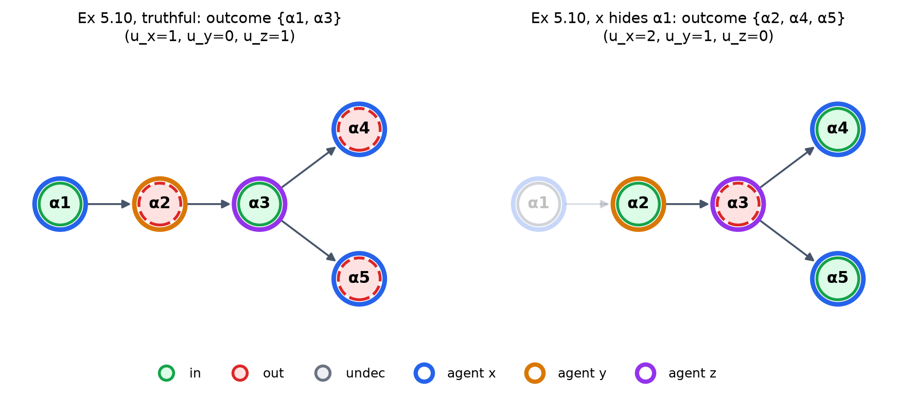
</div>

<div class="toc-title"><h1>Contents</h1></div>

[TOC]

## 1. Introduction

This report covers Assignment 3, which has two parts and an experimental study.

1. **Argumentation engine.** A Python implementation of Dung-style abstract argumentation frameworks ⟨A, ⇀⟩. It provides conflict-freeness, defence, the characteristic function, admissible and complete sets, and functions that compute the **grounded, complete, preferred, stable and semi-stable** extensions, all **legal in/out/undec labellings**, and the **acceptance status** of an argument.
2. **Strategic argumentation.** An implementation of the *grounded direct argumentation mechanism* (Rahwan, Sec. 5.4), in which self-interested agents report a subset of their arguments. It includes a best-response search, an exhaustive check of strategyproofness (Theorem 5.3), and a check of the graph-theoretic sufficient condition of Theorem 5.4 that works on graphs with cycles.
3. **Experiments.** 3 000 random instances (3 agents, 6–8 arguments, attack probability p ∈ {0.15, 0.25, 0.35}), plus a second batch of 3 000 without self-attacks. For each we record whether the mechanism is strategyproof and whether the Theorem 5.4 condition holds, and we answer the three questions of the assignment.

All four deliverables are in the submission:

| Deliverable | Where |
|---|---|
| **Code** | `argumentation/` (library), `experiments.py`, `plots.py`, `tests/` (35 unit tests) |
| **README** | `README.md`: how to run everything, file structure, mapping from spec item to function |
| **Report** | this document (`REPORT.pdf`, built from `report/REPORT.md` by `report/build_report.py`) |
| **Demonstration** | `demo.py` (terminal walk-through) and `web_demo.py` (live, animated browser demo), Section 6 |

The core library uses only the Python standard library. matplotlib is used only to draw plots, and WeasyPrint only to build this PDF.

## 2. Background

All definitions follow Chapter 5 of the course book, and the numbering below is the book's.

### 2.1 Argumentation frameworks

**Definition 5.1.** An *argumentation framework* is a pair AF = ⟨A, ⇀⟩, where A is a finite set of arguments and ⇀ ⊆ A × A is a defeat (attack) relation. For a set S ⊆ A, write S⁺ = {β | α ⇀ β for some α ∈ S} for the arguments S attacks, and α⁻ = {β | β ⇀ α} for the attackers of α.

| Concept | Definition (book) |
|---|---|
| Conflict-free (Def 5.2) | S ∩ S⁺ = ∅ |
| S defends α (Def 5.2) | α⁻ ⊆ S⁺: S attacks every attacker of α |
| Characteristic function (Def 5.3) | F(S) = {α ∈ A : S defends α} |
| Admissible (Def 5.4) | S conflict-free and S ⊆ F(S) |
| Complete extension (Def 5.5) | S conflict-free and S = F(S) |
| Grounded (Def 5.7) | the minimal complete extension = least fixed point of F, reached by iterating F from ∅ |
| Preferred (Def 5.7) | a maximal (⊆) complete extension, equivalently a maximal admissible set |
| Stable (Def 5.7) | S⁺ = A \ S |
| Semi-stable (Def 5.7) | a complete extension S whose *range* S ∪ S⁺ is maximal |

### 2.2 Labellings and acceptance

**Definition 5.6.** A *labelling* is a total function L : A → {in, out, undec}. It is *legal* when, for every argument α:
- L(α) = out exactly when some attacker of α is in;
- L(α) = in exactly when every attacker of α is out;
- otherwise L(α) = undec.

The in-sets of the legal labellings are exactly the complete extensions (Caminada). The other semantics then pick out particular labellings (Table 5.1):
- grounded: minimal in (equivalently, maximal undec);
- preferred: maximal in;
- semi-stable: minimal undec;
- stable: empty undec.

**Definition 5.8.** Given the extensions E₁ … Eₙ under a semantics, an argument is:
- **skeptically accepted** if it belongs to every Eᵢ;
- **credulously accepted** if it belongs to some Eᵢ;
- **rejected** if it belongs to none.

### 2.3 Argumentation mechanism design

Each agent i has a *type* Aᵢ ⊆ A, the arguments it can put forward (Def 5.17). The attack relation is common knowledge.

In the **grounded direct argumentation mechanism** (Def 5.21), each agent reports a set Aᵢ° ⊆ Aᵢ. Agents may *hide* arguments but cannot invent them. The outcome is the grounded extension of the graph induced by A₁° ∪ … ∪ Aₙ°.

Agents have *acceptability-maximising preferences* (Def 5.22): uᵢ(o) = |o ∩ Aᵢ|, the number of the agent's own arguments that are accepted.

<div class="box">
<p><b>Theorem 5.3 (characterisation).</b> The mechanism is strategyproof if and only if, for every agent i, every S ⊆ Aᵢ and every report A₋ᵢ of the others,
|Aᵢ ∩ GR(Aᵢ ∪ A₋ᵢ)| ≥ |Aᵢ ∩ GR((Aᵢ \ S) ∪ A₋ᵢ)|. In words, revealing everything is always a best response.</p>
<p><b>Theorem 5.4 (sufficient condition).</b> If no agent holds two arguments α, β such that there is an <i>odd-length</i> directed path from α to β in the full graph, then the mechanism is strategyproof.</p>
</div>

The intuition behind Theorem 5.4: along a path of attacks, an odd-length path acts like an attack and an even-length path acts like a defence. If no agent has an odd path between two of its own arguments, each of its arguments can only, directly or indirectly, *defend* its other arguments, never undermine them. So withholding an argument can never raise the agent's own count.

## 3. Implementation

### 3.1 Project structure

```text
argumentation/framework.py     Part 1: ArgumentationFramework class and all semantics
argumentation/strategic.py     Part 2: mechanism, best response, Thm 5.3, Thm 5.4, diagnostics
argumentation/book_examples.py fixtures: Figures 5.1-5.5, Examples 5.10/5.11, Exercises 1-2
experiments.py                 random-instance experiments -> results*/ (CSV, JSON, plots)
plots.py                       matplotlib plots saved into results*/plots/
tests/                         35 unit tests (book answers + randomised property checks)
demo.py, web_demo.py, web/     terminal and browser demonstrations
report/                        this report: source, figures, build and screenshot scripts
```

### 3.2 Part 1: the argumentation engine

`ArgumentationFramework(arguments, attacks)` stores, for every argument, its set of attackers α⁻ and the set of arguments it attacks, as frozensets. All set operations are then simple set algebra.

| Spec item | Method | How it works |
|---|---|---|
| 1. framework class | `ArgumentationFramework`, `restrict(S)` | validates attacks; `restrict` builds the induced sub-framework |
| 2. conflict-free | `is_conflict_free(S)` | S ∩ S⁺ = ∅ (a self-attacking argument is never conflict-free) |
| 3. defence | `defends(S, α)` | α⁻ ⊆ S⁺ |
| 4. characteristic function | `characteristic(S)` / `F(S)` | {α : α⁻ ⊆ S⁺} |
| 5. admissible / complete | `is_admissible`, `is_complete` | S ⊆ F(S) / S = F(S), both conflict-free |
| 6A. grounded | `grounded_extension()`, `grounded_trace()` | iterate F¹(∅), F²(∅), … until a fixed point |
| 6B. complete | `complete_extensions()` | in-sets of all legal labellings |
| 6C. preferred / stable / semi-stable | `preferred_extensions()`, `stable_extensions()`, `semi_stable_extensions()` | chosen from the complete extensions by Table 5.1 |
| 6D. labellings | `legal_labellings()` | backtracking search (below) |
| 6E. acceptance status | `acceptance_status(α, semantics)` | Def 5.8 over the extensions of that semantics |

**Grounded extension.** F is monotone, so iterating it from ∅ climbs to its least fixed point (Dung, 1995). The trace F¹(∅), F²(∅), … is also returned, so that the demo can animate it.

**Legal labellings.** The arguments are labelled one at a time with in/out/undec. An argument is checked against Def 5.6 as soon as it *and all of its attackers* have labels, and a branch is abandoned at the first violation. This makes enumeration fast even though there are 3ⁿ candidate labellings. A brute-force method, `complete_extensions_bruteforce()`, tries every subset with `is_complete`. The tests use it to confirm that the two methods always agree.

**Edge cases.**
- If a semantics has no extensions (stable semantics on an odd cycle), every argument is reported as *rejected*, never vacuously as "skeptically accepted".
- Unknown arguments raise `ValueError`.

### 3.3 Part 2: the grounded direct mechanism

| Spec item | Function | Notes |
|---|---|---|
| 1. mechanism | `mechanism(attacks, reports)` | grounded extension of the graph induced by ⋃ reports |
| utility | `utility(o, Aᵢ)` | \|o ∩ Aᵢ\|, counted on the *true* type |
| 2. best response | `best_responses(attacks, types, i, others)` | enumerates all 2^\|Aᵢ\| reports and returns every maximiser |
| 3. Theorem 5.3 check | `check_theorem_53(attacks, types)` | exhaustive; returns a witness when manipulable |
| 4. Theorem 5.4 check | `check_theorem_54(attacks, types, path_mode)` | odd *walks* (default) or odd *simple paths* |

**Fast mechanism.** The strategyproofness check evaluates the mechanism many times per instance, so `ArgumentationGame` converts each instance to **bitmasks**: argument k is bit k, and each argument stores a mask of its attackers. The grounded extension of a revealed set R is then computed by the standard grounded-labelling loop:
1. label `in` every argument of R whose attackers within R are all `out`;
2. label `out` every argument attacked by an `in` argument;
3. repeat until nothing changes.

The result is also **cached by R**, because the outcome depends only on the *union* of the reports. A test checks this fast version against the engine on every subset of 200 random graphs.

**Theorem 5.3 (exhaustive check).** For each agent i, and each union of reports the other agents could make (every combination of subsets of their types), the checker compares the truthful utility with that of every Aᵢ° ⊆ Aᵢ. With disjoint types, the profiles for agent i (others' reports × i's own reports) are exactly the 2ⁿ subsets of all arguments. A whole instance therefore costs at most 3 · 2⁸ = 768 grounded computations, almost all of them cache hits. If a profitable lie exists, a witness is returned: the agent, the others' reports, the hidden set, and the outcomes and utilities.

**Theorem 5.4 on cyclic graphs.** The spec asks for explicit handling of cycles. Searching paths naively on a cyclic graph can loop forever, and the parity of a path can change by going around an odd cycle. We search the product graph of (argument, parity of path length so far), starting from (α, even). There are only 2n states, each visited once, so the search **always terminates**. A directed walk α ⇝ β of odd length exists exactly when (β, odd) is reachable. `odd_walk_witness` rebuilds a shortest such walk for display. A second mode, `path_mode="simple"`, lists **simple** paths (no repeated arguments) exhaustively with a DFS, which is cheap for 8 arguments. This lets us compare the two readings of "path" (Section 5.6).

**Diagnosing Q3 instances.** `diagnose_sp_despite_violation` explains *why* a strategyproof instance fails the condition, using the first of these rules that applies:
1. the connection is a walk but not a simple path;
2. the only violations are self-defeating arguments;
3. the target β is never accepted in any profile;
4. hiding the source α from the truthful report never reinstates β;
5. hiding α does reinstate β, but the agent loses at least as much elsewhere. This splits further according to whether the loss is α itself or other own arguments.

### 3.4 Design decisions

1. **Self-attacks are allowed** in random instances ("each possible attack" includes (a, a)). A second run without them shows how sensitive the results are to this choice (Section 5.5).
2. **α = β counts** in the Theorem 5.4 check. A self-attack, or an odd cycle through one of an agent's own arguments, is a violation. A path of length 1 (a direct attack) also counts, so the condition includes "each type is conflict-free".
3. **Walks are the primary reading of "path"**. This is the safer, stricter reading on cyclic graphs; the simple-path reading is also reported.
4. **Lies are only by hiding** (Aᵢ° ⊆ Aᵢ), as in the book. An external verifier rules out invented arguments.
5. **Arguments are split uniformly at random** among the agents. An agent may receive no arguments (564 of the 3 000 main instances), and such an agent trivially cannot manipulate.

## 4. Verification on the book's examples

### 4.1 Engine

<figure class="w80">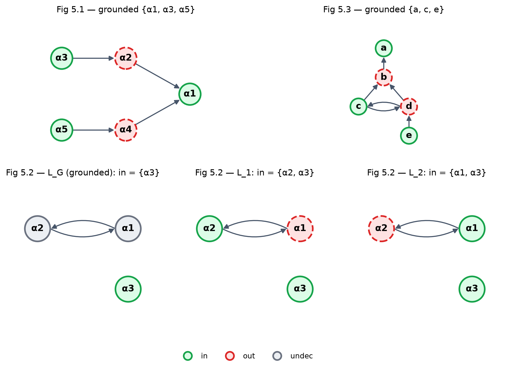
<figcaption><b>Figure 1.</b> Book Figures 5.1–5.3 coloured by our engine. Top: grounded extensions. Bottom: the three legal labellings of Figure 5.2, matching the book's L_G, L_1, L_2.</figcaption></figure>

| Example | Book's statement | Our result |
|---|---|---|
| Fig 5.1, Ex 5.5 | admissible: ∅, {α3}, {α5}, {α3,α5}, {α1,α3,α5} | identical ✔ |
| Fig 5.1, Ex 5.6 | F({α3}) = F({α5}) = {α3,α5}; only complete extension {α1,α3,α5} | identical ✔ |
| Fig 5.1 (grounded) | F¹(∅) = {α3,α5}, F²(∅) = F³(∅) = {α1,α3,α5} | identical ✔ |
| Fig 5.2, Ex 5.7, 5.8 | complete {α3}, {α1,α3}, {α2,α3}; grounded {α3}; preferred {α1,α3}, {α2,α3} | identical ✔ |
| Fig 5.3 | grounded {a, c, e} | identical ✔ |
| Exercise 1 | (answer not given) | complete ∅, {d}, {a,d}, {b,d}; grounded ∅; preferred = stable = semi-stable {a,d}, {b,d} |
| Exercise 2 (odd cycle) | (answer not given) | only the all-undec labelling; grounded = preferred = semi-stable = ∅; **no stable extension** |

### 4.2 Strategic examples

<figure>
<figcaption><b>Figure 2.</b> Example 5.10. Truthful reporting gives {α1, α3} (u_x = 1). If x hides α1, the outcome becomes {α2, α4, α5} and u_x = 2, so the mechanism is <b>not</b> strategyproof. Ring colour = owning agent; fill = grounded label.</figcaption></figure>

Our implementation reproduces Example 5.10 exactly:
- the truthful outcome is {α1, α3};
- hiding α1 raises x's utility from 1 to 2;
- revealing their true types weakly dominates revealing nothing for y and z;
- the Theorem 5.4 condition fails through α1 ⇝ α4 and α1 ⇝ α5 (α1 → α2 → α3 → α4, length 3).

<figure>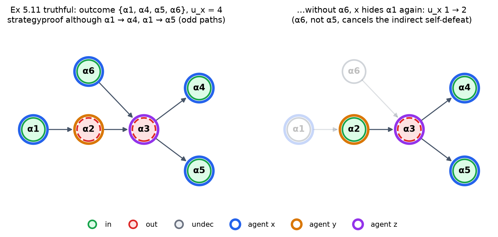
<figcaption><b>Figure 3.</b> Example 5.11. Left: with α6 → α3, truthful revelation gives x all four arguments, so the mechanism is strategyproof even though the condition fails. Right: remove α6 and the manipulation returns. Therefore α6, not α5, cancels the indirect self-defeat.</figcaption></figure>

### 4.3 Misprints in the book (confirmed)

<div class="box amber">
<p><b>Example 5.10.</b> The book writes u<sub>y</sub>(o, {α3}) = 1 and u<sub>z</sub>(o, {α2}) = 0, which swaps the two argument sets. With A<sub>y</sub> = {α2} and A<sub>z</sub> = {α3} our code gives the correct values <b>u<sub>y</sub> = 0 and u<sub>z</sub> = 1</b> (test <code>test_truthful_outcome</code>).</p>
<p><b>After Example 5.11.</b> The argument that cancels the indirect self-defeat is <b>α6</b>, not α5:</p>
<ul>
<li>removing α6 from x's type makes the mechanism manipulable again;</li>
<li>removing α5 leaves it strategyproof (test <code>test_a6_not_a5_cancels_self_defeat</code>, Figure 3).</li>
</ul>
</div>

### 4.4 Unit tests

The 35 tests check every statement above, plus randomised property checks on hundreds of graphs:
- grounded ⊆ every complete extension;
- stable ⊆ semi-stable ⊆ preferred ⊆ complete;
- maximal admissible sets = preferred extensions;
- the labelling-based and brute-force complete extensions agree;
- the bitmask mechanism equals the engine;
- the Theorem 5.4 condition ⇒ Theorem 5.3 on 400 random instances.

{{include:figures/tests.txt}}

## 5. Experiments

### 5.1 Setup

For each p ∈ {0.15, 0.25, 0.35} we generated **1 000 instances** (seed 42), 3 000 in total:
- the number of arguments n is drawn uniformly from {6, 7, 8};
- each ordered pair (a, b), self-pairs included, is an attack independently with probability p;
- each argument is given to one of the 3 agents uniformly at random.

For each instance we record:
- whether it is strategyproof, by the exhaustive Theorem 5.3 check;
- whether the Theorem 5.4 condition holds, under both the walk and the simple-path reading.

A second run (`--no-self-attacks`, same seed) forbids self-attacks. The full run takes under a second. The outputs are `results/instances.csv` (one row per instance), `summary.json`, `q2_instances.json`, `q3_examples.json` and the plots in `results/plots/`. They can be regenerated with:

```text
.venv/bin/python experiments.py
.venv/bin/python experiments.py --no-self-attacks --out results_no_self_attacks
```

### 5.2 Q1: fraction of strategyproof instances

| p | instances | mean #attacks | strategyproof | **fraction SP** (95% CI) | Thm 5.4 condition holds |
|---|---|---|---|---|---|
| 0.15 | 1000 | 7.4 | 553 | **55.3 %** (±3.1) | 38 (3.8 %) |
| 0.25 | 1000 | 12.4 | 256 | **25.6 %** (±2.7) | 2 (0.2 %) |
| 0.35 | 1000 | 17.5 | 129 | **12.9 %** (±2.1) | 0 (0.0 %) |

<figure class="w80">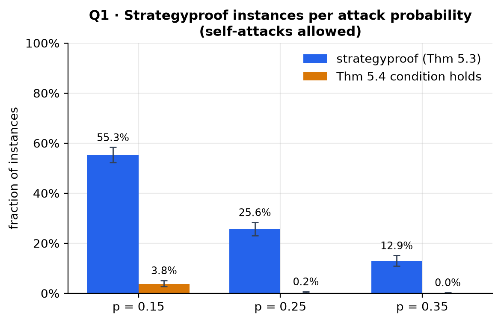
<figcaption><b>Figure 4.</b> Fraction of instances that are strategyproof (blue) and that satisfy the Theorem 5.4 condition (orange), with 95% Wilson intervals.</figcaption></figure>

**Strategyproofness falls sharply as the graph gets denser:** from about one instance in two at p = 0.15 to about one in eight at p = 0.35. Figures 5 and 6 show that the number of attacks drives this. Instances with at most 3 attacks are strategyproof at least 85 % of the time, while those with 18 or more attacks are strategyproof less than 10 % of the time. Larger graphs (n = 8) are less often strategyproof than small ones (n = 6) at every p, because each agent holds more arguments and the graph has more paths that can link them.

<figure class="w80">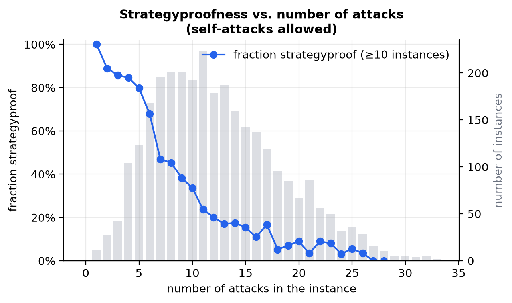
<figcaption><b>Figure 5.</b> Fraction strategyproof against the number of attacks in the instance (bars: number of instances).</figcaption></figure>

<figure class="w60">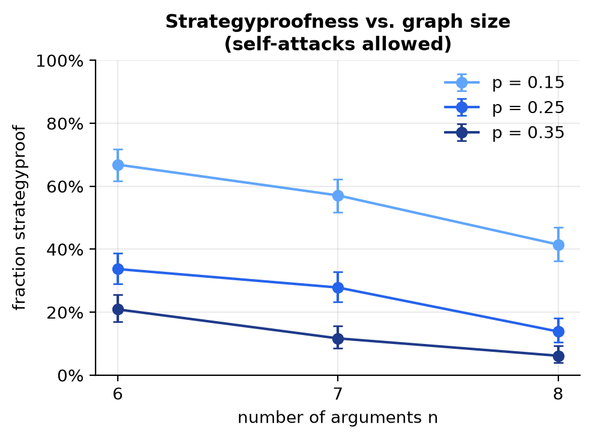
<figcaption><b>Figure 6.</b> Fraction strategyproof by number of arguments n, for each p. At p = 0.15 it falls from 66.9 % (n = 6) to 41.5 % (n = 8).</figcaption></figure>

The Theorem 5.4 condition is **much rarer** than strategyproofness itself (3.8 % / 0.2 % / 0 %). With about 2–3 arguments per agent, an odd path, or a self-attack, between two of an agent's own arguments appears very easily.

### 5.3 Q2: condition holds but not strategyproof

<div class="box green"><p><b>Result: 0 instances.</b> In both runs (6 000 instances), and under both the walk and the simple-path reading, no instance satisfies the Theorem 5.4 condition while failing strategyproofness. <code>q2_instances.json</code> is empty.</p></div>

<figure class="w80">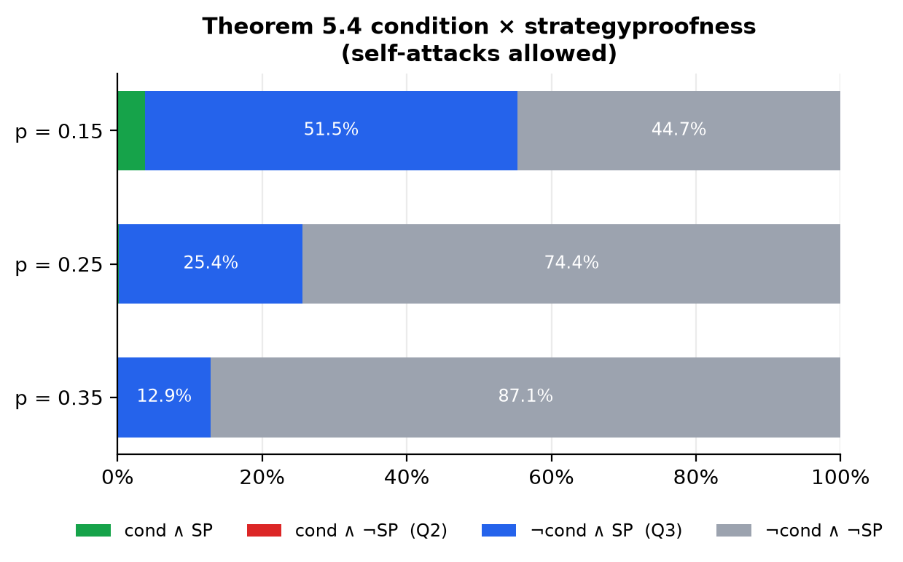
<figcaption><b>Figure 7.</b> Condition × strategyproofness for each p. The red segment (Q2: condition holds but not strategyproof) is empty at every p.</figcaption></figure>

**Explanation.** This is exactly what Theorem 5.4 predicts, since its condition is *sufficient* for strategyproofness. If an agent has no odd path between two of its own arguments, each of its arguments can only directly or indirectly *defend* its other arguments, never attack them. Hiding an argument can therefore only take away support, so the agent's count of accepted arguments can never rise. The experiment is evidence that our two independent checks (the exhaustive Theorem 5.3 search and the graph condition) are consistent.

The condition held in only **40** instances in the main run and **154** in the no-self-attack run, so this test is limited by the rarity of the condition. The unit test `test_theorem_54_implies_53` checks 400 further random instances. The two readings of "path" also agreed everywhere (Section 5.6), so the result does not depend on that choice.

### 5.4 Q3: strategyproof although the condition fails

Strategyproof instances that fail the condition are **common**: **898 of 3 000** in the main run (515, 254 and 129 at the three values of p) and **877** without self-attacks. In fact *almost every* strategyproof instance fails the condition: 898 of the 938 strategyproof instances. So the condition is sufficient but very far from *necessary*, as Example 5.11 already suggested. Each Q3 instance was classified by `diagnose_sp_despite_violation`:

| Reason (first that applies) | main | no self-att. | What happens |
|---|---|---|---|
| Hiding gains nothing on balance | **480** | 645 | The odd path is usually a *direct attack* α → β between the agent's own arguments, with α accepted. Hiding α frees β but loses α: +1 − 1 = 0. |
| Hiding never frees the target | **225** | 83 | Taking α away never makes β accepted, because β is also kept out or undec by another attacker (an unattacked argument, a self-attacker, an odd cycle). |
| Hiding loses other own arguments (α6 effect) | **78** | 146 | Hiding α does free β, but α was also *defending* other own arguments, which are lost. The loss outweighs the gain, as α6 does in Example 5.11. |
| Target never accepted | **63** | 0 | β is never accepted in any profile (e.g. it attacks itself), so there is nothing to win. |
| Only self-attacking arguments | **52** | 3 | The only violations are (α, α) for an α that attacks itself directly or through an odd cycle. Such an α is never accepted, and hiding it does not help its owner. |

<figure class="w80">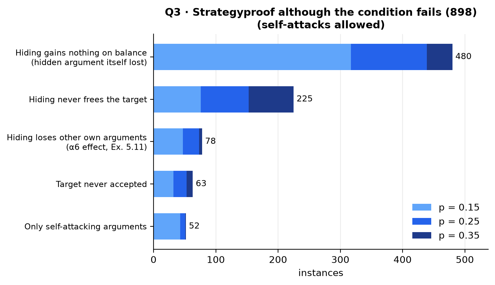
<figcaption><b>Figure 8.</b> Q3 instances by reason, stacked by p.</figcaption></figure>

The following five instances, one per reason and all taken from `results/q3_examples.json`, show the mechanism behind each reason. Each figure shows the truthful outcome next to the outcome when the agent hides the offending argument.

<figure class="w80">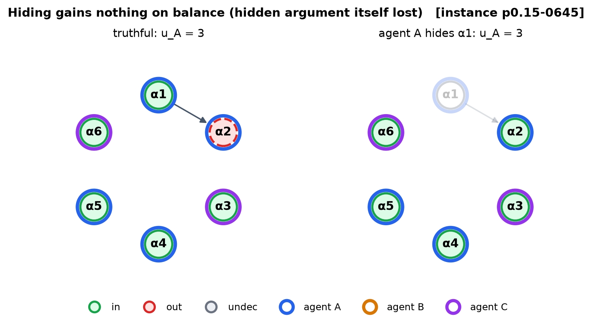
<figcaption><b>Figure 9.</b> Instance p0.15-0645: A = {α1, α2, α4, α5}, C = {α3, α6}, single attack α1 → α2.</figcaption></figure>

**Hiding gains nothing on balance.** α1 attacks α2 and both belong to A, so A's type is not even conflict-free. Truthfully, α1 is accepted and α2 is out, so u_A = 3. Hiding α1 makes α2 accepted, but α1 is then no longer in the outcome, so u_A stays 3. Nothing attacks α1, so it is accepted whenever revealed. The swap is therefore always one-for-one and never profitable. This is the most frequent reason, because at low p the typical violation is a single direct attack between two arguments of the same agent.

<figure class="w80">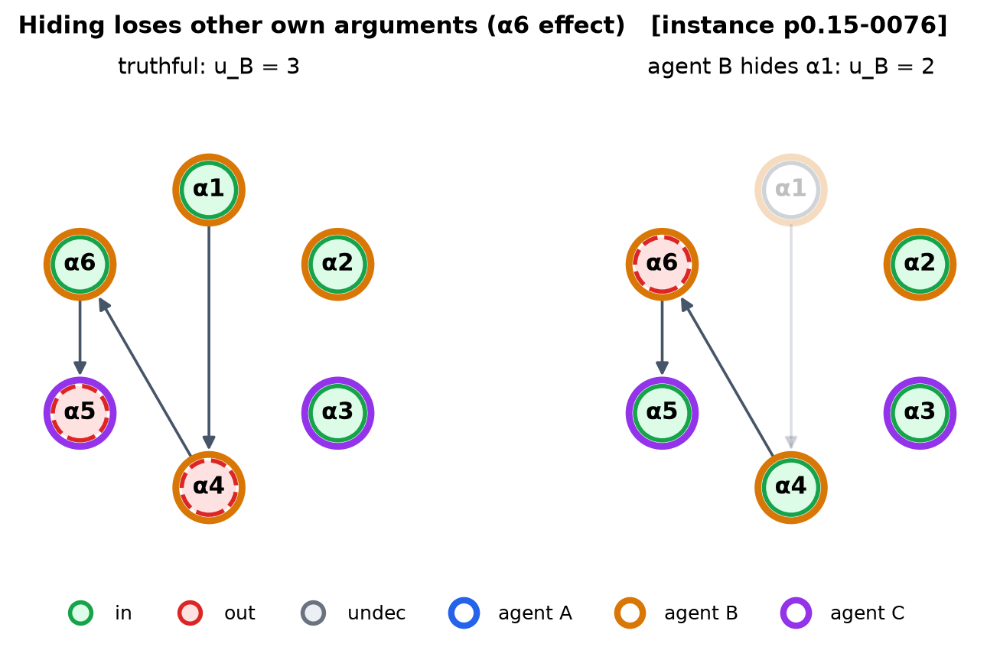
<figcaption><b>Figure 10.</b> Instance p0.15-0076: B = {α1, α2, α4, α6}, C = {α3, α5}, attacks α1 → α4 → α6 → α5.</figcaption></figure>

**Hiding loses other own arguments (the α6 effect).** B has an odd path α1 ⇝ α4 (length 1), and α1 also *defends* α6 through an even path (α1 → α4 → α6). Truthfully, u_B = 3 (α1, α2, α6). If B hides α1, then α4 becomes accepted, but α6 is now attacked by an accepted α4 and drops out, so u_B = 2. The same argument both hurts and helps its owner, and the help outweighs the harm. This is exactly why α6 makes Example 5.11 strategyproof.

<figure class="w80">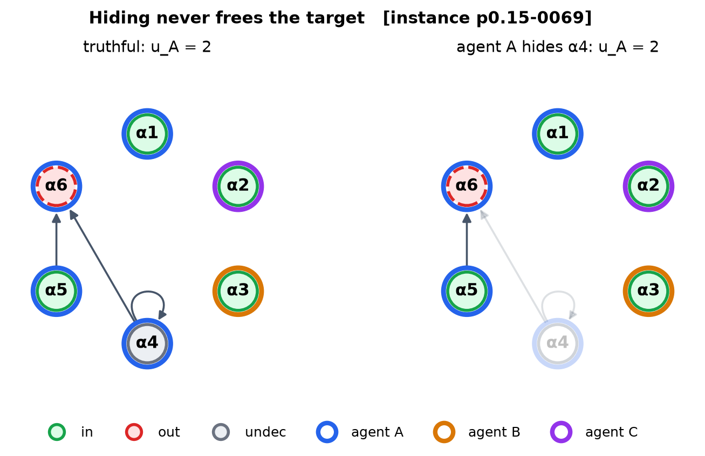
<figcaption><b>Figure 11.</b> Instance p0.15-0069: A = {α1, α4, α5, α6}; attacks α4 → α4, α4 → α6, α5 → α6.</figcaption></figure>

**Hiding never frees the target.** α6 has two attackers, both owned by A: the self-attacking α4 (always undec) and the unattacked α5 (always in). Hiding α4 leaves α6 out because of α5. Hiding α5 leaves α6 undec because of α4, and loses α5 as well. Hiding both frees α6 but gives up α5, so u_A = 2 in every case. No single odd path can be "cut" profitably, because the target has another attacker.

<figure class="w80">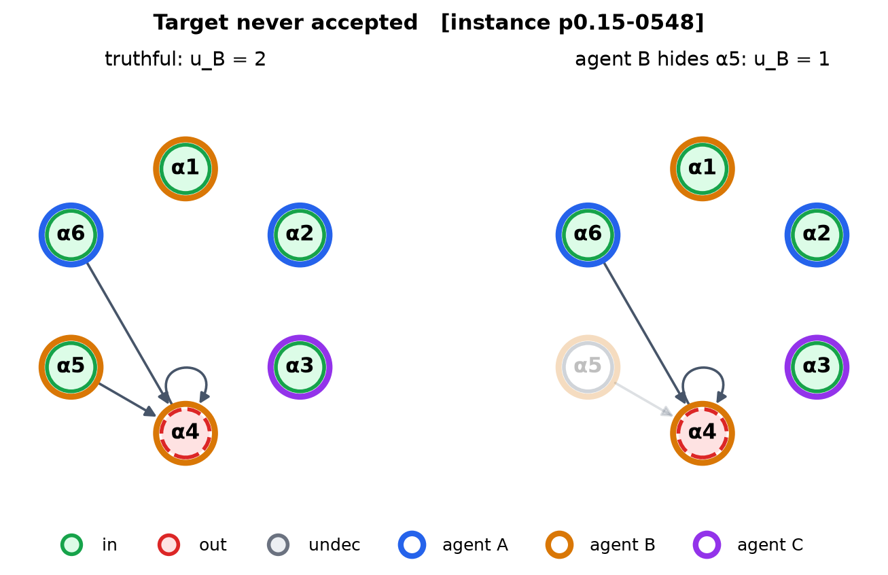
<figcaption><b>Figure 12.</b> Instance p0.15-0548: B = {α1, α4, α5}, A = {α2, α6}; attacks α4 → α4, α5 → α4, α6 → α4.</figcaption></figure>

**Target never accepted.** The target α4 attacks itself, so it is never accepted in any profile. B's odd path α5 ⇝ α4 is irrelevant: hiding α5 only loses α5 (u_B drops from 2 to 1). This reason disappears entirely in the run without self-attacks.

<figure class="w80">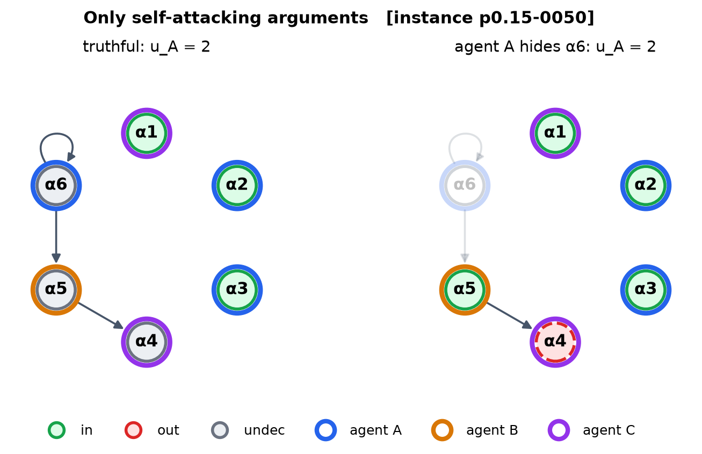
<figcaption><b>Figure 13.</b> Instance p0.15-0050: A = {α2, α3, α6}; attacks α6 → α6, α6 → α5, α5 → α4.</figcaption></figure>

**Only self-attacking arguments.** A's only violation is α6 ⇝ α6 (a self-attack, length 1). α6 is always undec, so it never counts towards A's utility. Hiding it changes the outcome for *other* agents: α5 becomes accepted and α4 drops out. A's own accepted arguments {α2, α3} are unaffected. The condition flags this case, but it poses no strategic risk for A.

**Summary for Q3.** The Theorem 5.4 condition is triggered by *any* odd path, but a lie only pays when *all* of the following hold:
1. some own argument β is defeated *only* through an odd path from the agent's own argument α (no other attacker keeps it out);
2. hiding α actually reinstates β;
3. hiding α does not lose more than it gains: α itself, and any own arguments α defended through even paths.

Random graphs very often violate (1) or (3), which explains the large Q3 counts.

### 5.5 Effect of self-attacks

<figure>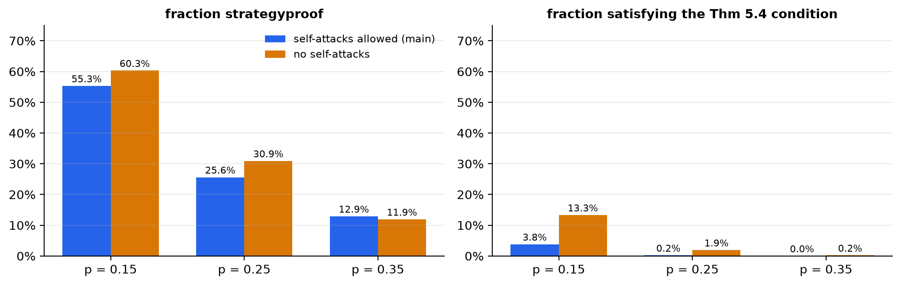
<figcaption><b>Figure 14.</b> Main run (self-attacks allowed) against the run without self-attacks.</figcaption></figure>

| p | SP (self-att.) | SP (none) | condition (self-att.) | condition (none) | Q2 (both) |
|---|---|---|---|---|---|
| 0.15 | 55.3 % | 60.3 % | 3.8 % | 13.3 % | 0 |
| 0.25 | 25.6 % | 30.9 % | 0.2 % | 1.9 % | 0 |
| 0.35 | 12.9 % | 11.9 % | 0.0 % | 0.2 % | 0 |

**Effect on the condition.** Forbidding self-attacks makes the condition hold **3.5× more often** at p = 0.15. This is because a self-attacking argument violates it on its own (2 503 of the 3 000 main instances contain at least one self-attack).

**Effect on strategyproofness.** The change is small (about 5 points, and within the noise at p = 0.35). Self-attacking arguments are never accepted, so they mostly add rejected arguments rather than profitable lies.

**Conclusions unchanged.** In both runs Q2 = 0 and Q3 is large. The reasons "target never accepted" and "only self-attacking arguments" almost vanish without self-attacks, and their share moves to the two "hiding gains nothing / loses own arguments" reasons.

### 5.6 Further observations

**Walks or simple paths?**
- The two readings of "odd-length path" gave **identical** verdicts on all 6 000 instances.
- They *can* differ in principle: an odd cycle inside a path flips its parity (test `test_walk_vs_simple`). The web demo also showed a random instance where a4 ⇝ a6 exists only as the walk a4 → a2 → a2 → a6.
- On the random instances, though, whenever an agent had a walk-only violation it also had some other violation that is a simple path, so the instance-level verdict never changed.

**How agents lie.**
- **2 062** of the 3 000 main instances are manipulable.
- In the witness found by the checker, the liar hides a **single argument** in 1 779 of them (86 %), two arguments in 245, three in 32, and four in 6.
- Most manipulations therefore look like Example 5.10: one argument that indirectly defeats the agent's own arguments is withheld.

## 6. Demonstration

There are two demonstrations. Both compute everything live with the submitted library; the only thing read from disk is the experiments tab of the web demo, which displays the saved `summary.json` files.

### 6.1 Terminal demonstration: `python3 demo.py`

`demo.py` walks through every function on the book examples. Part 1 covers sets S, F(S), the grounded trace, all extensions, labellings and acceptance tables. Part 2 covers Examples 5.10 and 5.11, best responses, both theorems and the misprints, and ends with a mini experiment. An excerpt of Part 2:

{{include:figures/demo_part2.txt}}

### 6.2 Live browser demonstration: `python3 web_demo.py`

`web_demo.py` is a small standard-library HTTP server that exposes the package as a JSON API. The page in `web/` draws the argument graphs as SVG and animates every change: labels fading in, hidden arguments ghosting out, utility bars growing, odd paths lighting up edge by edge. All screenshots below were taken automatically from the running demo (`report/screenshots.py`).

<figure class="shot">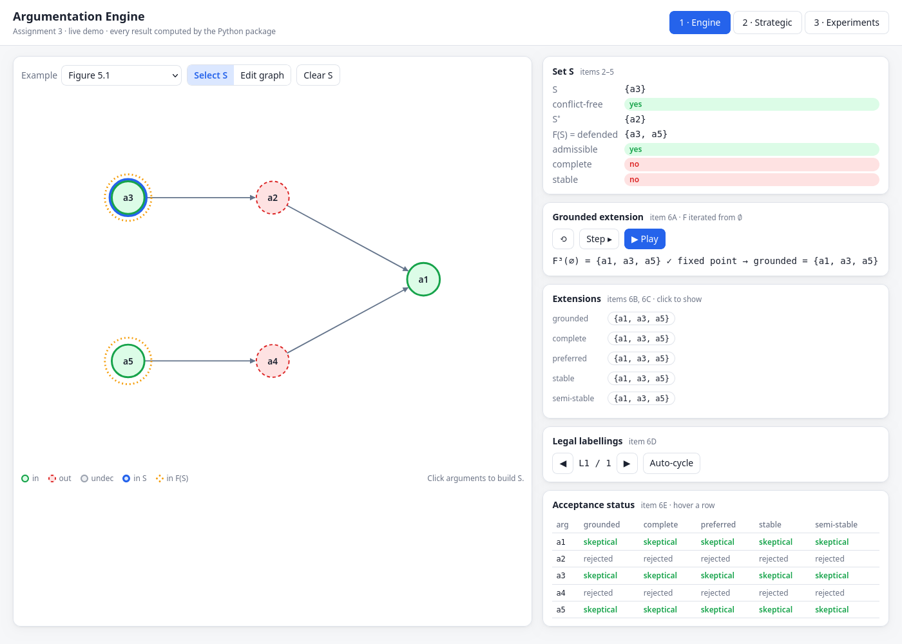
<figcaption><b>Figure 15.</b> Engine tab, Figure 5.1. S = {α3} is selected (blue ring), and F(S) = {α3, α5} is marked (orange dotted). The set panel reports conflict-free / admissible / not complete. <b>▶ Play</b> has animated F¹(∅), F²(∅), F³(∅) up to the grounded fixed point, and the acceptance-status table is shown for all five semantics.</figcaption></figure>

<figure class="shot">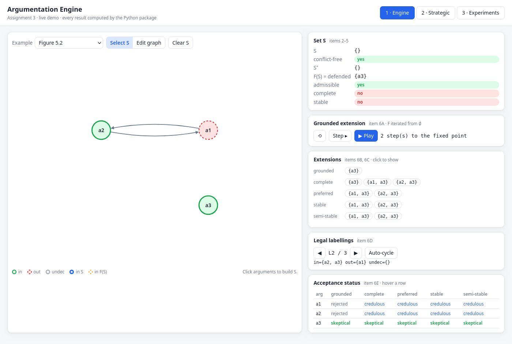
<figcaption><b>Figure 16.</b> Engine tab, Figure 5.2: stepping through the three legal labellings (here L₂: in = {α2, α3}, out = {α1}), with all extensions and credulous/skeptical statuses.</figcaption></figure>

<figure class="shot">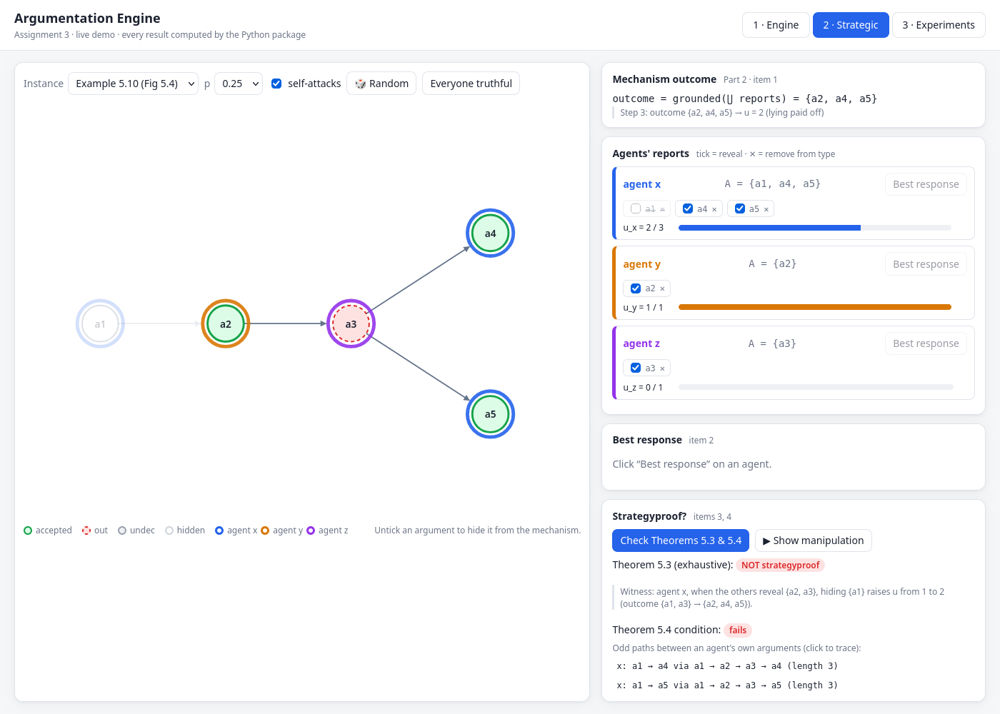
<figcaption><b>Figure 17.</b> Strategic tab, Example 5.10, after <b>▶ Show manipulation</b>. α1 has been hidden (faded), the outcome changed to {α2, α4, α5}, and x's utility bar grew from 1/3 to 2/3. The Theorem 5.3 verdict, the witness and the odd paths α1 ⇝ α4, α1 ⇝ α5 are listed.</figcaption></figure>

<figure class="shot">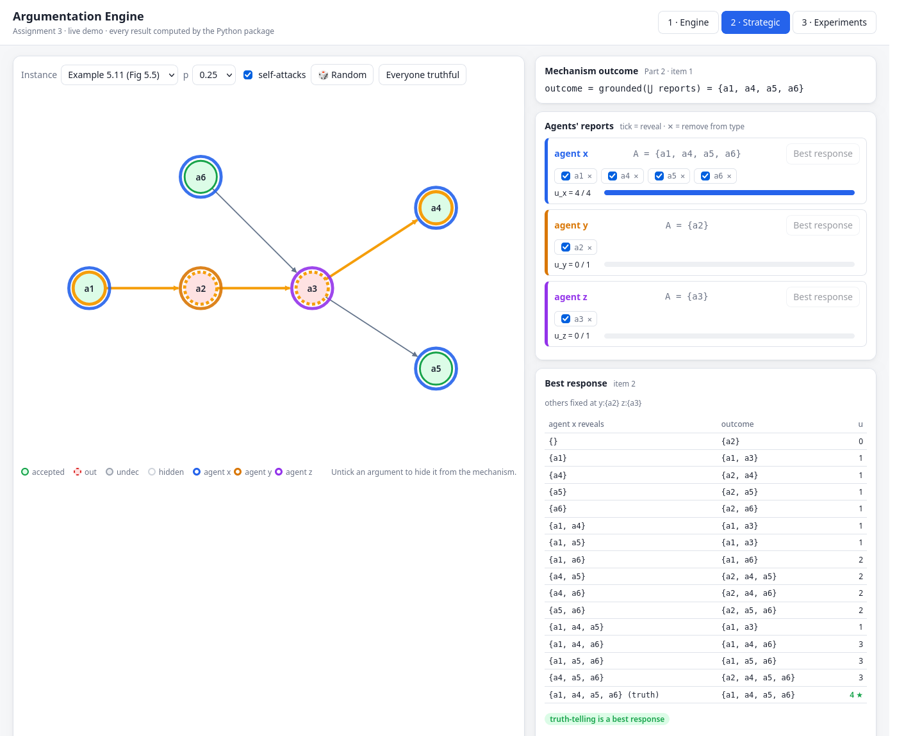
<figcaption><b>Figure 18.</b> Example 5.11. The odd walk α1 → α2 → α3 → α4 is traced in orange, and x's best-response table (all 16 reports) shows that truth-telling (u = 4) is optimal.</figcaption></figure>

<figure class="shot">
<figcaption><b>Figure 19.</b> A random instance (p = 0.25) that is strategyproof although the condition fails. The demo explains why: agent C hiding α1 frees α4 but loses α1 and α6 (the α6 effect).</figcaption></figure>

<figure class="shot">
<figcaption><b>Figure 20.</b> Experiments tab: Q1 charts for both runs, Q2 = 0, the Q3 breakdown and the contingency table.</figcaption></figure>

<figure class="shot w80">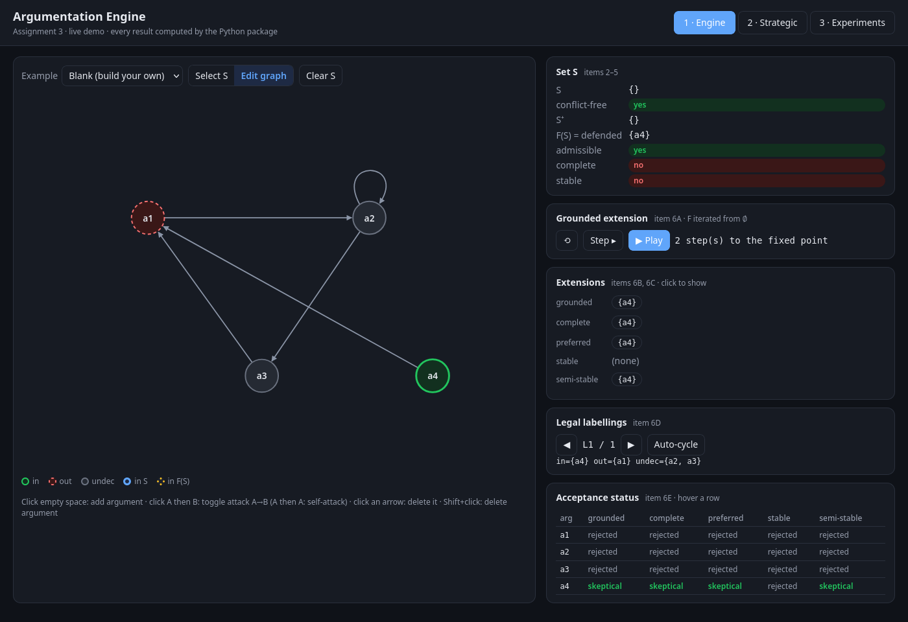
<figcaption><b>Figure 21.</b> Graph editor (dark theme). A user-built graph with a self-attack and a cycle, analysed live: grounded {α4}, no stable extension.</figcaption></figure>

## 7. Discussion and conclusion

**Correctness.** The engine reproduces every answer stated in Chapter 5, and so does the mechanism, including Examples 5.10 and 5.11. Both misprints mentioned in the assignment were confirmed by computation. Independent implementations agree with each other (labellings vs. brute force, bitmask vs. set-based grounded semantics), and theoretical relations between the semantics hold on hundreds of random graphs.

**Strategic findings.**
1. The grounded direct mechanism is **frequently manipulable** with acceptability-maximising agents, and increasingly so as graphs get denser: 55 %, 26 % and 13 % strategyproof at p = 0.15, 0.25, 0.35.
2. Theorem 5.4's condition **was never violated in the "wrong" direction** (Q2 = 0), which is consistent with it being a sufficient condition.
3. The condition is **very conservative**: it holds in at most 3.8 % of instances, while 30–60 % are strategyproof at the lower densities. Most strategyproof instances escape it because a lie must reinstate a target that nothing else defeats, *and* must not cost the liar its own accepted or defended arguments.

**Limitations.**
- The condition is rare, so Q2 rests on 40 (main) / 154 (no self-attack) condition-satisfying instances plus 400 unit-test instances.
- Generating instances *conditioned* on the condition holding would test Q2 more strongly.
- Exhaustive checking is exponential in the number of arguments (2ⁿ profiles). It is trivial for n ≤ 8 but would need smarter search for much larger graphs.

## 8. Reproducing the results

```text
python3 -m venv .venv && .venv/bin/pip install -r requirements.txt   # matplotlib, markdown, weasyprint
python3 -m unittest discover -s tests -v                             # 35 tests
python3 demo.py                                                      # terminal demonstration
python3 web_demo.py                                                  # live browser demo (http://localhost:8000)
.venv/bin/python experiments.py                                      # results/ (+ plots/)
.venv/bin/python experiments.py --no-self-attacks --out results_no_self_attacks
.venv/bin/python report/screenshots.py                               # web-demo screenshots (needs Firefox)
.venv/bin/python report/build_report.py                              # figures + REPORT.pdf
```

## References

1. I. Rahwan, "Argumentation among Agents," Ch. 5 in G. Weiss (ed.), *Multiagent Systems*, 2nd ed., MIT Press, 2013.
2. P. M. Dung, "On the acceptability of arguments and its fundamental role in nonmonotonic reasoning, logic programming and n-person games," *Artificial Intelligence* 77(2):321–357, 1995.
3. M. Caminada, "On the issue of reinstatement in argumentation," *JELIA 2006*, LNCS 4160, pp. 111–123.
4. I. Rahwan and K. Larson, "Mechanism design for abstract argumentation," *AAMAS 2008*, pp. 1031–1038.

## Appendix A. Raw experiment output

{{include:figures/experiments_main.txt}}

{{include:figures/experiments_noself.txt}}
